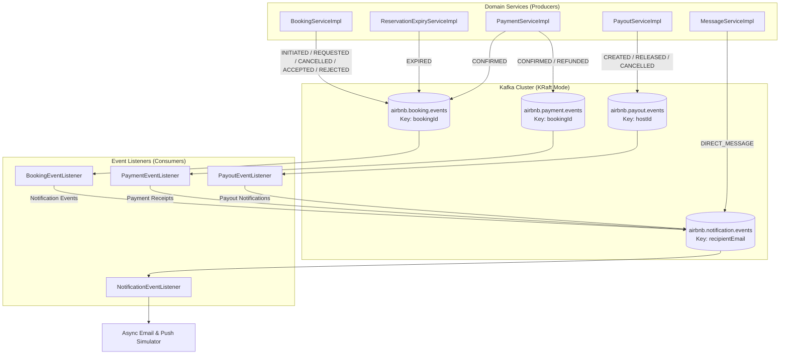

# AirBNB Clone (Spring Boot)


## Overview
A production-grade, enterprise backend architecture replicating the core functionalities of Airbnb. Built with modern Java 25 and Spring Boot 4.0.2, this platform powers high-concurrency booking orchestration, dynamic inventory management with surge control, automated 15-minute reservation hold expiration, geospatial map searching (Haversine & viewport bounding box), an itemized fee breakdown engine with escrow host payouts, verified-stay double-blind reviews with subcategory ratings & Guest Favorite badges, wishlists, guest-host threaded messaging, tiered cancellation policy engine, instant-book vs. host-approval workflows, high-speed **Redis in-memory caching** with graceful degradation, an event-driven architecture powered by **Apache Kafka**, and interactive OpenAPI 3 (Swagger UI) documentation.

---

## 🚀 Interactive OpenAPI & Swagger Documentation
Interactive API documentation is enabled and accessible at:
- **Swagger UI**: [`http://localhost:8080/api/v1/swagger-ui/index.html`](http://localhost:8080/api/v1/swagger-ui/index.html)
- **OpenAPI v3 Specification**: [`http://localhost:8080/api/v1/v3/api-docs`](http://localhost:8080/api/v1/v3/api-docs)

> [!NOTE]
> All secured endpoints can be tested directly from Swagger UI by clicking the **Authorize** button and providing your JWT Bearer token obtained from `/auth/login`.

---

## ⚡ Event-Driven Architecture (EDA) with Apache Kafka

The platform utilizes **Apache Kafka** (`spring-kafka`) to decouple transaction processing from downstream side-effects (e.g. notifications, receipts, escrow payouts, and email dispatchers). All domain events are partitioned to maintain strict per-booking and per-host order.



### Kafka Topics & Event Schemas
| Topic Name | Key Partitioning | Event DTO | Triggers |
| :--- | :--- | :--- | :--- |
| **`airbnb.booking.events`** | `bookingId` | `BookingEvent` | Emitted when bookings are initiated (`INITIATED`), requested (`REQUESTED`), accepted (`ACCEPTED`), rejected (`REJECTED`), confirmed (`CONFIRMED`), cancelled (`CANCELLED`), or expired (`EXPIRED`). |
| **`airbnb.payment.events`** | `bookingId` | `PaymentEvent` | Emitted when payments are confirmed (`CONFIRMED`) or refunds issued (`REFUNDED`). |
| **`airbnb.payout.events`** | `hostId` | `PayoutEvent` | Emitted when host escrow payouts are scheduled (`CREATED`), released (`RELEASED`), or cancelled (`CANCELLED`). |
| **`airbnb.notification.events`** | `recipientEmail` | `NotificationEvent` | Emitted for all asynchronous user alerts, booking receipts, host payout deposits, and direct messages. |

---

## ⚡ High-Speed Caching Tier (Redis)

The application integrates **Spring Data Redis** (`spring-boot-starter-data-redis`) configured with a custom `RedisCacheManager` using polymorphic JSON serialization (`GenericJackson2JsonRedisSerializer` with `JavaTimeModule`).

### Cache Regions & TTL Policies
| Cache Region | Entity / DTO | TTL | Invalidation Trigger (@CacheEvict) |
| :--- | :--- | :---: | :--- |
| **`hotelDetails`** | `HotelResponse` | 1 Hour | Evicted when a host updates, activates, deactivates, or deletes their hotel listing. |
| **`hotelRatings`** | `RatingSummaryResponse` | 30 Minutes | Evicted when a guest submits a new verified stay review. |
| **`userProfiles`** | `UserResponse` | 15 Minutes | Evicted when a user updates their account profile information. |

### Graceful Degradation (Fail-Safe)
The caching tier implements a custom `CacheErrorHandler`. If Redis is offline or encounters connection timeouts, cache misses automatically log a warning and fall back directly to PostgreSQL without crashing or rejecting user requests.

---

## Key Enterprise Features

### 1. High-Concurrency Booking & 15-Minute Reservation Holds
- **Pessimistic Write Locking**: Employs `@Lock(LockModeType.PESSIMISTIC_WRITE)` on room inventory rows to eliminate race conditions under concurrent bookings.
- **Reservation Hold TTL Sweeper**: Automated background job (`@Scheduled(fixedRate = 60000)`) sweeps unconfirmed `RESERVED` holds past 15 minutes, automatically cancels them, releases locked inventory, and dispatches a Kafka `BookingEvent(EXPIRED)`.
- **Manual Sweep Endpoint**: Admins/Managers can invoke `POST /admin/bookings/expire-holds` to immediately purge stale reservation holds.

### 2. Instant Book vs. Host Request-to-Book Workflow
- **Listing Toggle**: Listings configure `instantBookable` (`true`/`false`).
- **Approval Workflow**: When `instantBookable` is `false`, bookings start in `REQUESTED` status holding inventory without immediate charge and notifying the host.
- **Host Actions**: Hosts can review and take action:
  - `POST /admin/hotels/{hotelId}/bookings/{bookingId}/accept`: Approves request, moves status to `RESERVED`, resets the 15-minute guest payment window, and sends an approval event.
  - `POST /admin/hotels/{hotelId}/bookings/{bookingId}/reject`: Rejects request, moves status to `CANCELLED`, immediately releases the inventory back to the pool, and notifies the guest.

### 3. Tiered Cancellation Policy & Pre-Cancellation Quote
- **Policy Engine**: Calculates exact refunds based on notice period prior to check-in:
  - **`FLEXIBLE`**: 100% full refund if cancelled $\ge 24\text{ hours}$ before check-in. Inside 24 hours, the first night is non-refundable (credited to host), while remaining nights and cleaning fee are refunded.
  - **`MODERATE`**: 100% full refund if cancelled $\ge 5\text{ days}$ before check-in. Inside 5 days, 50% accommodation penalty applies (cleaning fee + 50% accommodation refunded).
  - **`STRICT`**: 50% accommodation refund if cancelled $\ge 7\text{ days}$ before check-in (+ cleaning fee). Inside 7 days, accommodation is completely non-refundable; cleaning fee is refunded.
- **Pre-Cancellation Quote**: `GET /bookings/{id}/cancellation-quote` lets guests inspect exact refund, penalty, and host payout amounts before confirming cancellation.

### 4. Escrow Host Payout Architecture
- **Delayed Escrow Release**: Payouts are not sent immediately upon booking. Escrow records (`Payout` with `PENDING_ESCROW`) are scheduled for release **24 hours post-check-in** to protect guests from fraudulent listings.
- **Daily Automated Sweeper**: `@Scheduled(cron = "0 0 1 * * *")` automatically releases all escrow payouts due on or before today and emits Kafka `PayoutEvent(RELEASED)`.
- **Admin Management & Overrides**: Endpoints for host payout tracking (`GET /admin/payouts/my-payouts`), all system payouts (`GET /admin/payouts`), manual releases (`POST /admin/payouts/{id}/release`), and manual sweep triggers (`POST /admin/payouts/sweep`).

### 5. Guest-Host Threaded Messaging System
- **Threaded Conversations**: Dedicated messaging channels (`Conversation`) tied to bookings and listings between guests and hosts.
- **Chat & Unread Counters**:
  - `POST /conversations/messages` or `POST /bookings/{bookingId}/messages`: Send instant messages and emit Kafka `NotificationEvent(DIRECT_MESSAGE)`.
  - `GET /conversations`: User inbox with last message preview and unread counters.
  - `GET /conversations/{id}/messages`: View message history and automatically mark incoming messages as read.
  - `GET /conversations/unread-count`: Fast unread notification badge counter.

### 6. Itemized Fee Architecture
- **Itemized Price Breakdown**: Real-time calculation of:
  - Nightly base rate total across stay dates.
  - Length-of-stay weekly discounts (e.g. 10% off for 7+ nights).
  - Host cleaning fees.
  - Airbnb platform guest service fee (14% of accommodation total).
  - Occupancy tax (5% of subtotal before tax).
- **Host Escrow Earnings**: Automatically calculates net host payout deducting 3% platform commission (`(accommodation + cleaning) * 0.97`).

### 7. Geospatial & Bounding-Box Map Search
- **Haversine Distance**: Calculates real-time distance in kilometers between user search coordinates `(latitude, longitude)` and hotel locations.
- **Viewport Bounding Box**: Supports map panning search via bounding coordinates (`minLat`, `maxLat`, `minLng`, `maxLng`).
- **Radius Filtering**: Filters hotels within a configurable radius (e.g. 30 km) and sorts results by proximity.

### 8. Verified-Stay Reviews & Wishlists
- **Verified Stay Validation**: Only guests with completed, past-date `CONFIRMED` stays can post reviews.
- **6 Subcategory Ratings**: Ratings for Cleanliness, Accuracy, Communication, Location, Check-in, and Value.
- **Guest Favorite Badge**: Automatically awarded to listings maintaining an overall rating $\ge 4.8$ with $\ge 5$ verified reviews.
- **Wishlists**: Add/remove favorite properties with `POST /wishlists/toggle/{hotelId}` and fetch user wishlist feeds.

---

## Technical Architecture & Data Model

### Core Entities
| Entity | Description | Key Relationships |
| :--- | :--- | :--- |
| **User** | System users (Guests, Hosts, Admins). | `1:N` Bookings, `1:N` Hotels (if Host), `1:N` Wishlists, `1:N` Reviews |
| **Hotel** | Property listing with geolocation, fees, instantBookable flag, policies. | `1:N` Rooms, `1:N` Inventory, `1:N` Reviews, `Many:1` Owner |
| **Room** | Accommodation unit within a hotel. | `Many:1` Hotel, `1:N` Inventory |
| **Inventory** | Daily availability, surge factor, price, and closed status. | `Many:1` Room, `Many:1` Hotel |
| **Booking** | Reservation record with status (`REQUESTED`, `RESERVED`, `CONFIRMED`, `CANCELLED`). | `Many:1` User, `Many:1` Room, `1:1` Payment, `Many:Many` Guests |
| **Payout** | Host escrow payout tracking (`PENDING_ESCROW`, `RELEASED`, `CANCELLED`). | `Many:1` Booking, `Many:1` Host |
| **Conversation**| Threaded guest-host communication channel. | `Many:1` Booking, `Many:1` Guest, `Many:1` Host, `1:N` Messages |
| **Message** | Individual chat message with read receipt status. | `Many:1` Conversation, `Many:1` Sender |
| **Review** | Verified stay review with 6 subratings. | `Many:1` Hotel, `Many:1` User, `1:1` Booking |
| **Wishlist** | User saved properties. | `Many:1` User, `Many:1` Hotel |
| **Payment** | Financial transaction simulation. | `1:1` Booking |

---

## API Endpoints Reference

### Authentication (`/auth`)
| Method | Endpoint | Description | Access |
| :--- | :--- | :--- | :--- |
| `POST` | `/auth/signup` | Register a new user | Public |
| `POST` | `/auth/login` | Login and receive JWT token | Public |

### User Profile (`/users`)
| Method | Endpoint | Description | Access |
| :--- | :--- | :--- | :--- |
| `GET` | `/users/profile` | View profile of authenticated user | Authenticated |
| `PUT` | `/users/profile` | Update profile information | Authenticated |

### Public Search, Browsing & Price Quotes (`/hotels`)
| Method | Endpoint | Description | Access |
| :--- | :--- | :--- | :--- |
| `GET` | `/hotels/search` | Search by city or geo-coords (`lat`, `lng`, `radiusKm`) or bounding box | Public |
| `GET` | `/hotels/{id}` | View public details of an active hotel with rating summary | Public |
| `GET` | `/hotels/{hotelId}/rooms/{roomId}/pricing` | Get price quote with itemized fee breakdown & daily rates | Public |
| `GET` | `/hotels/{hotelId}/reviews` | Fetch paginated reviews for a hotel | Public |
| `GET` | `/hotels/{hotelId}/rating-summary` | Fetch subrating statistics & Guest Favorite badge | Public |

### Bookings (`/bookings`)
| Method | Endpoint | Description | Access |
| :--- | :--- | :--- | :--- |
| `POST` | `/bookings` | Create booking (reserves directly or requests host approval) | Authenticated |
| `GET` | `/bookings/{id}` | View booking details with itemized fees | Owner / Admin |
| `GET` | `/bookings/my-bookings` | List authenticated user bookings | Authenticated |
| `GET` | `/bookings/{id}/cancellation-quote`| Preview tiered refund & penalty quote before cancelling | Owner / Admin |
| `POST` | `/bookings/{id}/cancel` | Cancel booking, process tiered refund & adjust host escrow | Owner / Admin |
| `POST` | `/admin/hotels/{hotelId}/bookings/{bookingId}/accept` | Host accepts booking request | Host / Admin |
| `POST` | `/admin/hotels/{hotelId}/bookings/{bookingId}/reject` | Host rejects booking request & releases inventory | Host / Admin |
| `GET` | `/admin/hotels/{hotelId}/bookings` | List all bookings for hotel | Host / Admin |
| `POST` | `/admin/bookings/expire-holds` | Manually sweep and release stale 15-minute reservation holds | Admin / Manager |

### Guest-Host Messaging (`/conversations`)
| Method | Endpoint | Description | Access |
| :--- | :--- | :--- | :--- |
| `POST` | `/conversations/messages` | Send message in existing conversation or booking | Authenticated (Participant) |
| `POST` | `/bookings/{bookingId}/messages` | Send message directly linked to a booking | Authenticated (Participant) |
| `GET` | `/conversations` | Get user conversation inbox with unread counts | Authenticated |
| `GET` | `/conversations/{id}/messages` | View messages in thread and mark incoming as read | Authenticated (Participant) |
| `GET` | `/conversations/unread-count` | Get total unread message counter | Authenticated |

### Escrow Payouts (`/admin/payouts`)
| Method | Endpoint | Description | Access |
| :--- | :--- | :--- | :--- |
| `GET` | `/admin/payouts/my-payouts` | Host retrieves their escrow payouts | Host / Admin |
| `GET` | `/admin/payouts` | View all platform escrow payouts | Admin |
| `POST` | `/admin/payouts/{id}/release` | Admin manual release of escrow payout | Admin |
| `POST` | `/admin/payouts/sweep` | Trigger escrow payout release sweep | Admin |

### Wishlists (`/wishlists`)
| Method | Endpoint | Description | Access |
| :--- | :--- | :--- | :--- |
| `POST` | `/wishlists/toggle/{hotelId}` | Toggle property in user wishlist | Authenticated |
| `GET` | `/wishlists` | Retrieve all wishlisted properties of authenticated user | Authenticated |

### Reviews (`/reviews`)
| Method | Endpoint | Description | Access |
| :--- | :--- | :--- | :--- |
| `POST` | `/reviews` | Submit verified stay review with subratings | Authenticated (Past Guest) |
| `GET` | `/reviews/hotel/{hotelId}` | Fetch paginated reviews for a hotel | Public |
| `GET` | `/reviews/hotel/{hotelId}/summary` | Fetch rating breakdown & Guest Favorite status | Public |

### Payments (`/payments`)
| Method | Endpoint | Description | Access |
| :--- | :--- | :--- | :--- |
| `POST` | `/payments/process` | Submit payment, confirm booking, and create escrow payout. Supports `Idempotency-Key` header | Authenticated |
| `GET` | `/payments/booking/{bookingId}` | Check payment transaction status | Owner / Admin |

### Actuator & Health Probes (`/actuator`)
| Method | Endpoint | Description | Access |
| :--- | :--- | :--- | :--- |
| `GET` | `/actuator/health` | Application liveness, readiness, disk, DB & Redis health probes | Public |
| `GET` | `/actuator/info` | Application metadata and build details | Public |
| `GET` | `/actuator/metrics` | JVM, HTTP, connection pool, and thread metrics | Public |

---

## 🛡️ Enterprise Reliability & Security Additions

### 1. Payment Idempotency Key (`Idempotency-Key` HTTP Header)
To guarantee zero duplicate charges across network retries, clients can provide a unique UUID in the `Idempotency-Key` header when calling `POST /api/v1/payments/process`.
- Backed by Redis (`idempotency:payment:{userId}:{key}`) with a 24-hour TTL.
- Repeated requests with the identical key immediately return the original, cached `PaymentResponse` without executing redundant charges, updating inventory, or publishing duplicate Kafka events.

### 2. Redis-Backed Sliding-Window Rate Limiting
Brute-force protection on authentication endpoints:
- Limits `/auth/login` to **10 requests per minute** per client IP (respecting `X-Forwarded-For` and `X-Real-IP` behind reverse proxies).
- Atomic Redis counter with automatic TTL expiry window.
- Exceeding the threshold triggers HTTP `429 Too Many Requests` with a structured RFC 7807 error payload.
- Fails open gracefully if Redis is temporarily unreachable.

### 3. Turnkey Sample Data Seeder (`DataInitializer`)
When the database is empty, the turnkey seeder automatically initializes a complete production-style environment:
| Role | Email | Password | Pre-seeded Resources |
| :--- | :--- | :--- | :--- |
| **Admin** | `admin@airbnb.com` | `admin123` | Full administrative control, manual payout release, hold sweeping |
| **Host** | `host@airbnb.com` | `host123` | Owner of 3 scenic luxury listings (Paris, Santorini, Zermatt) |
| **Guest** | `guest@airbnb.com` | `guest123` | 1 completed past booking, confirmed payment, and 5-star verified review |

* **3 Scenic Listings**:
  - *The Eiffel Luxury Penthouse* (Paris) with Penthouse Suite & Deluxe Queen room
  - *Santorini Cliffside Caldera Villa* (Santorini) with Cave Villa Master & plunge pool
  - *Matterhorn Alpine Chalet* (Zermatt) with Alpine Chalet Loft & sauna
* **90-Day Inventories**: Seeded for all rooms automatically on startup.

### 4. Correlation ID & Distributed Tracing (`CorrelationIdFilter`)
* Intercepts every inbound request at highest precedence.
* Reads `X-Correlation-ID` header or generates a unique UUID.
* Populates SLF4J `MDC` context (`correlationId`) across all log messages.
* Echoes `X-Correlation-ID` in HTTP response headers for end-to-end client-server traceability.

### 5. Real-Time STOMP WebSockets for Instant Messaging
* Configured STOMP message broker over native WebSockets and SockJS fallback at `/ws`.
* Subscriptions: `/topic/conversations/{conversationId}` for instantaneous multi-device chat synchronization without polling.
* Automatically broadcasts real-time chat messages when `POST /messages/send` is called alongside Kafka asynchronous email notifications.

### 6. Automated GitHub Actions CI/CD Pipeline
* Workflow: [`.github/workflows/ci.yml`](.github/workflows/ci.yml)
* Automated spin-up of **PostgreSQL 17** and **Redis 7** service containers in GitHub runners.
* Runs full automated test suite on **Java 25 (Temurin)** and publishes the release JAR artifact on every push and pull request.

### 7. Turnkey HTTP & Postman Test Suites
* **IntelliJ / VS Code REST Client**: [`requests.http`](requests.http) with pre-configured requests and automated JWT token extraction for Guest, Host, and Admin.
* **Postman Collection v2.1**: [`postman_collection.json`](postman_collection.json) with pre-configured folders, variables, and automated authorization scripts.

---

## 💻 Getting Started

### Prerequisites
* Java 25
* Maven (or included `./mvnw`)
* Docker & Docker Compose (or local PostgreSQL, Redis & Kafka)

### 1. Clone the Repository
```bash
git clone https://github.com/RupomChowdhury/airbnb-springboot.git
cd airbnb
```

### 2. Run Infrastructure with Docker Compose
To start PostgreSQL, Redis, Apache Kafka (KRaft mode), and Kafka UI in containers:
```bash
docker compose up -d
```
- **PostgreSQL**: Port `5432`
- **Redis (Cache Tier)**: Port `6379`
- **Apache Kafka**: Port `9092`
- **Kafka UI**: [`http://localhost:8085`](http://localhost:8085) (visual topic & message browser)

### 3. Execute Full Test Suite (72 Tests)
```bash
./mvnw test
```

### 4. Run Application
```bash
./mvnw spring-boot:run
```
The application will boot on port `8080` with context path `/api/v1`.

### 5. Open Swagger UI & Health Probes
- **Swagger UI**: [`http://localhost:8080/api/v1/swagger-ui/index.html`](http://localhost:8080/api/v1/swagger-ui/index.html)
- **Actuator Health Check**: [`http://localhost:8080/api/v1/actuator/health`](http://localhost:8080/api/v1/actuator/health)
- **WebSocket Handshake Endpoint**: `ws://localhost:8080/api/v1/ws`
